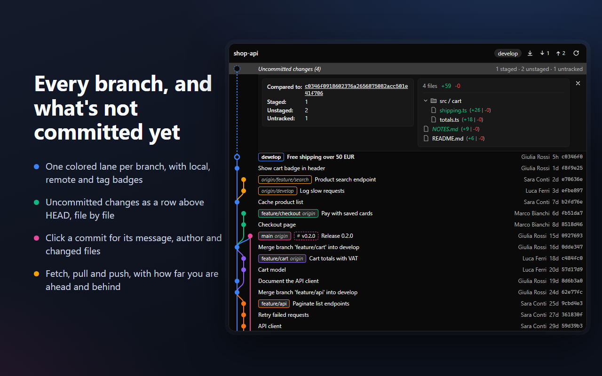
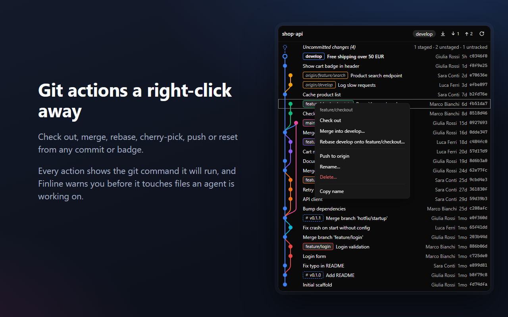

<p align="center">
  
</p>

<h1 align="center">orca-git-graph</h1>

<p align="center">
  A git graph for <a href="https://onorca.dev">Orca</a>: the commits of the focused worktree in
  colored lanes, with branches, tags and remotes, in Orca's right sidebar.
</p>

<p align="center"><em>fin</em> (an orca's fin) + <em>line</em> (the lanes of the graph).</p>

## Origin

This repository uses [dennib/finline](https://github.com/dennib/finline) version **0.3.1** as its
reference and starting point. It is being developed further from that base.

## Author

Song Hoang ([songhoang2000hn](https://github.com/songhoang2000hn))





## Features

- Commit graph drawn in SVG: one lane per branch, merges and forks as curves, HEAD as a hollow node.
- Ref badges: local branches together with their remote copy (`main · origin`), remote-only
  branches in italics, tags with a dashed border.
- Follows the focused Orca workspace and refreshes by itself when HEAD, branches, tags or the
  index change, from Orca, a terminal or an agent.
- Loads 200 commits at a time as you scroll.
- Click a commit to open its details under it: hash, parents, author and committer, the full
  message, and the changed files as a folder tree with line counts.
- Fits the narrow sidebar: author and hash columns appear only when there is room.
- Git actions from a right-click on a commit or a badge (or Shift+F10, or the ⋯ in the details):
  - branches and tags: check out, create, rename, delete, push, delete from the remote;
  - integration: merge, rebase, cherry-pick, revert, and a banner to continue or abort a stopped
    one;
  - reset (soft, mixed, hard) and copying a hash or name.
- Fetch, pull and push in the header, with how far the branch is ahead and behind.
- Works on workspaces on SSH hosts too: orca-git-graph runs the same git commands there through your
  system `ssh` (see [SSH hosts](#ssh-hosts)).
- Every action shows the git command it will run. orca-git-graph warns before changing files that have
  uncommitted changes or that an agent is working on, and asks before anything destructive.

Diffs are planned.

## Install

In Orca, open **Settings → Plugins**, search for **orca-git-graph** and install it. Then open the
**orca-git-graph** tab in the right sidebar.

Requires Orca 1.4.248 or later and `git` on your `PATH`.

## SSH hosts

For a workspace on an SSH host, orca-git-graph asks once for the ssh destination that reaches it, as
you would type it after `ssh` in a terminal on this computer: an alias from `~/.ssh/config` or
`user@host`. Orca tells plugins only an id for the host, not its address, so this can't be
filled in for you. The answer is kept per host; the server button in the header changes it.

- git runs on the host as `ssh <destination> git -C <path> …`, with `BatchMode=yes`: the login
  must work without a prompt (a key, or the ssh agent). On macOS and Linux, orca-git-graph shares one
  connection between its calls (`ControlMaster`, socket `~/.ssh/orca-git-graph-%C`, closed 5 minutes
  after the last call), so a refresh costs a few milliseconds per git call.
- There is no file watcher on the host, so orca-git-graph asks it every 4 seconds whether the refs or
  the uncommitted changes moved, and stops asking after 10 minutes without a panel request.
- Untracked files on a host are listed without line counts.
- The host needs `git` and a POSIX login shell (sh, bash, zsh).
- Orca does not list some remote workspaces to plugins at all (hosts that run Orca's managed
  server). For those, orca-git-graph takes the ssh alias Orca saved for the host (read-only, from Orca's
  own state, when there is a single remote host) or the one you give, then finds the workspace's
  folder from the workspace that host has focused, or by asking the Orca CLI on the host
  (`~/.orca/cli/bin/orca worktree list`).

## Access it asks for

orca-git-graph is a **full-access** plugin (`trusted-worker`): Orca asks you to approve it on install.

- **Runs a worker process** that calls your system `git` in the focused workspace's folder and
  watches that repository's `.git` folder for changes. For a workspace on an SSH host it runs
  your system `ssh` to the destination you gave it, and git there. It reads on its own; it changes the
  repository only when you pick an action, with fixed git arguments it validates first.
- **`workspace:read`**: reads the focused workspace's name and branch, and the list of workspaces,
  to find which repository to show.
- **`agent:read`**: sees whether an agent is working in the workspace, to warn you before an
  action changes its files.
- **`terminal:send`**: when a fetch, pull or push needs credentials git cannot ask for in the
  background, "Run in terminal" opens a new Orca terminal with that git command.

orca-git-graph itself makes no network requests and collects no data. Fetch, pull and push reach your
remotes through git, with your git credentials; SSH hosts are reached through `ssh`, with your
ssh keys and config.

## Known limitations

- Orca does not yet tell plugins the focused workspace's folder, so orca-git-graph matches it by name and
  branch. When two workspaces share both (for example two worktrees on `develop`), orca-git-graph asks you
  once which repository it is.
- Workspaces on remote runtimes (`runtime:` hosts, a paired Orca server) are not supported yet.

## Development

```sh
orca plugin dev watch .                # load this folder into Orca and stream its logs
node --test src/*.test.ts              # layout and git parser tests (Node >= 22.18)
orca plugin validate .                 # the catalog's manifest checks
```

- `src/worker.ts` (worker): resolves the repository, runs `git`, watches `.git`.
- `src/layout.ts`: assigns lanes and routes edges; pure, with tests.
- `src/graph/` (html panel): draws the graph and the commit list.

To try the panel on another repository, put its path in `.orca/dev-repo.txt` (git-ignored). The
worker then shows that repository instead of the focused workspace. `ssh:<destination>:<path>`
shows a repository on an SSH host.

Notes from the first prototype are in [docs/prototype-findings.md](docs/prototype-findings.md).

## License

[MIT](LICENSE) © 2026 Song Hoang and Denni Bevilacqua
